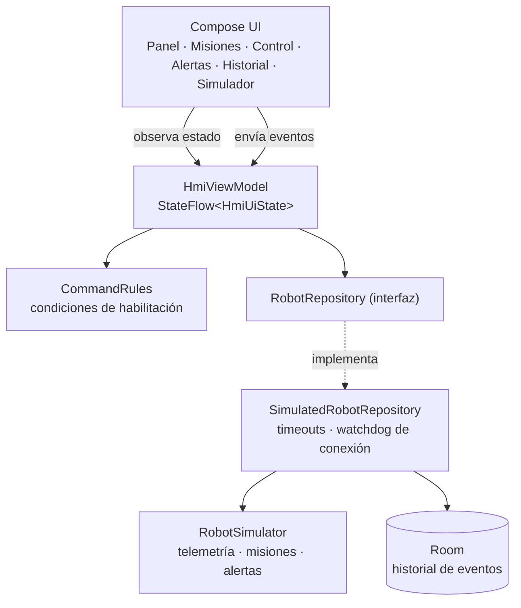

# HMI G1 Hospital — APK con telemetría simulada

TP grupal de Desarrollo de Aplicaciones I (UADE). App Android para que un operador supervise y controle un **Unitree G1 simulado** que acompaña a pacientes adultos mayores o con discapacidad visual dentro de un hospital. Funciona **sin robot, sin servidor y sin internet**.

## Cómo correrla

1. Abrí la carpeta `HmiG1` en **Android Studio** (Ladybug o posterior) con **JDK 17**.
2. Esperá a que termine el *Gradle sync*. La primera vez descarga dependencias, así que hace falta internet solo para compilar.
3. Ejecutá en un emulador o en un teléfono con Android 8.0 o superior (minSdk 26).
4. Para generar el APK instalable: **Build → Build App Bundle(s) / APK(s) → Build APK(s)**. El archivo queda en `app/build/outputs/apk/debug/app-debug.apk`.

## Stack

Kotlin · Jetpack Compose (Material 3) · MVVM · ViewModel · StateFlow · Room (historial) · Navigation Compose · Coroutines.

## Arquitectura



- La **UI** solo observa `HmiUiState` y envía eventos al ViewModel. Nunca accede al simulador.
- El **ViewModel** combina telemetría, comandos y un reloj de 1 s para calcular si los datos están viejos.
- El **Repository** es una interfaz. Hoy la implementa `SimulatedRobotRepository`. Para usar un robot real alcanzaría con otra implementación (WebSocket, ROS 2, etc.) sin tocar la UI.
- El **simulador** corre en memoria: actualiza batería y telemetría cada segundo, ejecuta misiones con estados coherentes, emite alertas y permite forzar desconexiones, rechazos e incidentes.
- **Room** persiste el historial: misiones, alertas, comandos y eventos de conexión.

### Estructura

```
app/src/main/java/com/uade/hmig1/
├── domain/            Modelos, reglas de habilitación (CommandRules) y tiempos del enlace (LinkPolicy)
├── data/
│   ├── RobotRepository.kt          Interfaz
│   ├── SimulatedRobotRepository.kt Implementación simulada
│   ├── sim/RobotSimulator.kt       Robot G1 simulado
│   └── local/EventDatabase.kt      Room
├── ui/
│   ├── HmiViewModel.kt · HmiApp.kt (navegación, confirmaciones, banner de desconexión)
│   ├── components/    Componentes reutilizables (mismos estados visuales que el Figma)
│   ├── screens/       Pantallas
│   └── theme/         Paleta
└── MainActivity.kt · HmiApplication.kt (inyección manual de dependencias)
```

## Telemetría

- **Estándar:** conectividad, batería, estado operativo, misión y progreso, ubicación (zona y piso), movimiento (m/s), alertas activas y última actualización.
- **Propia del servicio:**
  - distancia al paciente, con límite de 2,0 m;
  - estado del acompañamiento: localizando, acompañando, esperando entrega o entregado;
  - estado del sistema de voz.

## Comandos

Los comandos son: iniciar, pausar, reanudar y cancelar misión; volver a punto seguro; parada operativa; reconocer alerta.

- **Habilitación:** cada orden tiene sus condiciones (ver `CommandRules`). Si una orden no está disponible, el botón aparece deshabilitado con el motivo.
- **Estados visibles:** pendiente, confirmada, rechazada (con motivo) o sin respuesta (sin confirmación del robot tras 5 s).
- **Confirmación obligatoria:** cancelar, volver a punto seguro y parada operativa piden confirmación.
- **Reanudar con criterio:** no se puede reanudar con una alerta crítica sin reconocer, y después de una parada operativa hace falta confirmar un desbloqueo («Desbloquear y reanudar»).

> La parada operativa es un comando de software simulado y **no reemplaza una parada de emergencia física**. Una orden enviada no equivale a una orden ejecutada.

## Cómo demostrar los cinco escenarios

El ícono 🔧 de la barra superior abre el **Simulador de escenarios**.

| # | Escenario | Pasos |
|---|-----------|-------|
| 1 | Misión normal | En **Misiones**, ingresar `P-2847`, elegir *Consultorio 3B* e **Iniciar misión**. En el **Panel**: buscar paciente → acompañar (sala de espera → ascensor → pasillo B) → esperar entrega → misión completada → regreso a base. Dura unos 70 s. |
| 2 | Batería baja | Con una misión en curso, en el Simulador, **Forzar batería baja** (18%). Aparece una advertencia en Alertas con la acción **Volver a punto seguro**. En Misiones, **Iniciar misión** queda deshabilitado: «Batería insuficiente (≤ 20%)». |
| 3 | Desconexión | En el Simulador, apagar **Enlace con el robot**. A los 3 s: banner rojo en todas las pantallas, datos en gris con "DATOS OBSOLETOS" y contador de segundos. Enviar *Pausar* desde Control: queda **Pendiente** y a los 5 s pasa a **Sin respuesta**. Encender el enlace: vuelve la telemetría y el historial registra "Conexión recuperada". |
| 4 | Incidente: obstáculo | Con una misión acompañando, en el Simulador, **Generar obstáculo**. El robot se pausa solo y aparece una alerta crítica. **Reanudar** queda bloqueado hasta **Reconocer** la alerta. Después el operador decide: **Ruta alternativa** (reanudar), **Volver a punto seguro** o **Cancelar**. |
| 5 | Escenario propio: separación del paciente | Con una misión acompañando, **Paciente se aleja**. La distancia crece; al pasar 2,0 m el robot hace una pausa automática y aparece una alerta crítica. Reconocer la alerta, verificar al paciente y **Paciente reubicado** (reanudar). |

Extras del Simulador:

- **Rechazar próxima orden**: el robot rechaza el siguiente comando, para mostrar el estado *Rechazada*.
- **Señal WiFi**: fuerza señal débil (chip y WiFi en amarillo, sin perder el enlace).
- **Sistema de voz**: fuerza una falla del canal de voz (variable propia en estado *Error*).
- Obstáculo y separación solo se habilitan mientras el robot acompaña a un paciente.

## Riesgos contemplados en la interfaz

| Riesgo | Medida |
|--------|--------|
| Separación del paciente | Pausa automática y alerta crítica cuando supera 2,0 m. |
| Órdenes accidentales | Diálogo de confirmación en órdenes destructivas y botones deshabilitados según el estado. |
| Pérdida de conexión | Datos marcados como obsoletos, banner en todas las pantallas, órdenes sin respuesta y aviso de parada física. |
| Obstáculo o personas en el camino | Pausa y decisión explícita del operador. |
| Privacidad | Solo código interno del paciente (`P-0000`): sin nombre, DNI ni diagnóstico. |

## Decisiones y limitaciones

- **Un solo ViewModel compartido.** Es suficiente para el alcance del TP y simplifica que todas las pantallas compartan estado.
- **Inyección manual (`AppContainer`) en lugar de Hilt.** Tiene menos configuración y deja visible qué implementación se usa.
- **Room para el historial.** Pide el enunciado y permite consultas ordenadas. DataStore no sirve para listas de eventos.
- **La conexión perdida se detecta solo por antigüedad de datos (más de 3 s).** El Repository no "sabe" que el simulador cortó el enlace, como pasaría con un robot real.
- **Solo G1-01 es operable.** G1-02 y G1-03 se muestran para la selección de robot.
- **El simulador no modela la física ni la navegación real del G1.** La ruta y los tiempos son aproximados.
- **El contrato JSON es una propuesta del grupo** ([docs/contrato-json.md](docs/contrato-json.md)), **no el protocolo oficial de Unitree**.
